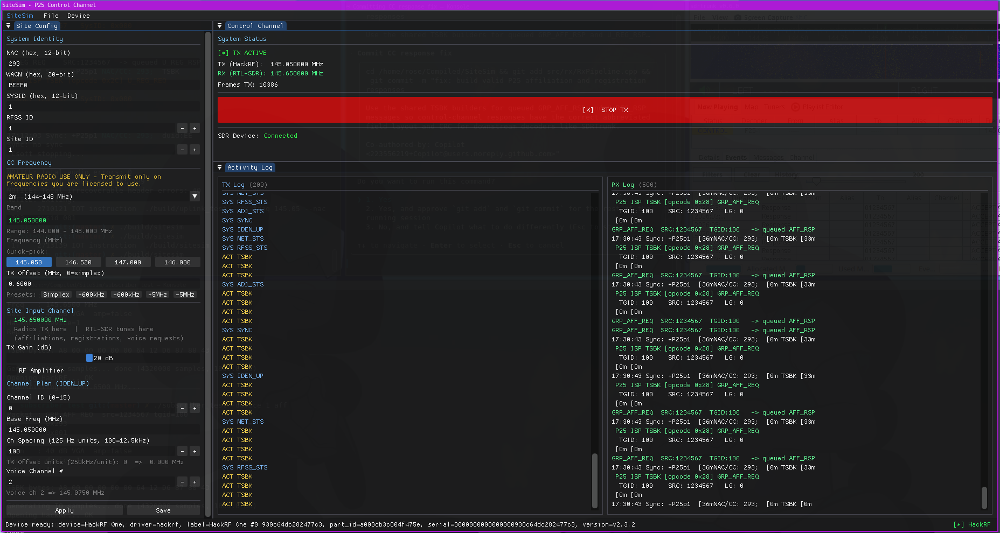

# SiteSim

`SiteSim` is a P25 Phase 1 site simulator focused on the two core halves of a trunked site:

- the **downlink control channel** transmitted by the site
- the **uplink / ISP path** transmitted by subscriber radios back to the site

The goal of the project is to let you stand up a small, understandable P25 site model, watch what it is doing, and test subscriber behavior against it.

> **RF / legal warning — read before transmitting**
>
> SiteSim keys a transmitter and can advertise and grant voice channels. Transmitting on a frequency you are not authorized to use is illegal in most countries and can interfere with public-safety, commercial, and other licensed systems.
>
> - Only transmit on **amateur radio bands**, and only if you hold a valid amateur license that covers the band and mode, and stay within your license's power and operating privileges.
> - Follow your national regulator's rules (for example FCC Part 97 in the US), the band plan, and any local coordination.
> - For bench and lab testing, transmit into a **dummy load or shielded enclosure**, or apply enough attenuation that essentially no RF is radiated. Do not connect a power amplifier.
> - Never operate SiteSim on public-safety, business, or any other spectrum you are not licensed for.
>
> The authors accept no liability for misuse or for any legal or regulatory consequences of operating this software.

## How the project is split up

### `sitesim`

This is the main application.

It has a GUI for configuring a site, starts the control channel transmitter, runs the uplink receiver, and shows both TX and RX activity logs at the same time.

### `uplink_test`

This is the uplink receiver path pulled out into a standalone tool.

It exists so the native in-process receive chain can be tested by itself, without involving the rest of the GUI application or control-channel transmitter. It can decode from a recorded IQ file (WAV / CF32), from a live RTL-SDR (librtlsdr), from a live SoapySDR device, or from a built-in loopback self-test that modulates known TSBKs and decodes them again.

### `subscriber_test`

This is a standalone subscriber-side test transmitter.

It sends mobile-originated P25 ISP messages with a HackRF so the uplink receiver can be exercised without a real subscriber radio.

## How SiteSim works

## 1. Control channel transmission

The control channel side continuously emits a P25 Phase 1 control stream.

It rotates through core system broadcasts that a subscriber expects to see on a live control channel, including things like:

- identifier updates
- network status
- RFSS status
- adjacent site status
- synchronization broadcast

When uplink activity causes the site to need to answer something, SiteSim queues a response TSBK into the control-channel scheduler. That queued message is then inserted into the outgoing control-channel stream and transmitted as part of the normal burst flow.

## 2. Uplink reception

The receive side is a native, in-process P25 Phase 1 receiver (`p25rx::P25Receiver`). It does not shell out to an external decoder.

The chain is the inverse of the transmitter:

- capture IQ — RTL-SDR via librtlsdr directly, or the shared SoapySDR device for a Pluto
- downconvert the deliberately off-centre capture to baseband (the RX is tuned
  away from the signal so it does not sit on the tuner DC spike) and decimate to
  ~48 kHz
- FM discriminator, then symbol timing locked per burst by **correlating the
  48-bit frame-sync word** (robust on short uplink bursts where a free-running
  timing loop would not settle)
- integrate over each symbol (matched filter), slice the 4-level C4FM
- NID (BCH) → de-interleave → 4-state Viterbi → CRC-16 to recover the TSBK

Examples of uplink traffic the receiver understands:

- group affiliation requests
- unit registration requests
- group voice channel requests
- unit-to-unit voice channel requests
- emergency alarm requests

Decoded TSBKs are logged and forwarded into SiteSim’s ISP handling, which drives the automatic site responses below.

## 3. Automatic site responses

When a valid uplink request is decoded, SiteSim can generate a matching control-channel response automatically.

For example:

- a `GRP_AFF_REQ` can cause a `GRP_AFF_RSP` to be queued
- a `GRP_VCH_REQ` causes a `GRP_VCH_GRANT` for the selected voice channel
- a `U_REG_REQ` can cause a `U_REG_RSP` to be queued

This means the uplink side and downlink side are tied together: subscriber actions heard on the uplink can immediately drive site behavior on the control channel.

## 4. Frequency model

SiteSim uses an editable **channel plan** instead of two fixed frequency boxes.
Add as many 2m/70cm channels as you need, then click the **CC** radio button on
the row the site should transmit on and the **VC** radio button on the voice
channel it should grant:

- **CC** — the control-channel transmit frequency.
- **VC** — the voice channel advertised in `IDEN_UP` and returned in
  `GRP_VCH_GRANT` responses.
- **Uplink / Site Input** — an explicit frequency for radio → site traffic
  (affiliation, registration, voice requests). This is where the RX radio
  tunes. The TX offset sent in `IDEN_UP` is derived from
  `uplink − control channel`; editing the control channel preserves that
  offset, and editing the uplink changes it.

The `IDEN_UP` band plan is derived automatically from the lowest frequency in
the plan and the selected spacing (6.25/12.5/25 kHz). The UI shows the resolved
channel numbers and refuses to apply/start if a channel is outside the amateur
bands or does not fit in the 4095-step IDEN range. Defaults are SYSID `0x123`,
a 12.5 kHz 70cm plan (control `438.8000`, voice `438.8125`, `438.8250`,
`438.8375` MHz), and a −5 MHz uplink split (`433.8000` MHz). Edit the uplink
field for your repeater's actual input; the offset sent in `IDEN_UP` follows.

## 5. Radio backends

SiteSim uses SoapySDR for the transmitter and its own native receiver for the uplink.

- **HackRF + RTL-SDR (default):** the control channel transmits on the SoapySDR
  device (HackRF), while the uplink receiver runs on a separate RTL-SDR captured
  directly through librtlsdr (RTLSDR AGC, tuned offset from the signal to dodge
  the tuner DC spike).
- **ADALM-Pluto (single radio, full duplex):** the Pluto performs both jobs at
  once. SiteSim opens one SoapySDR device, keeps the TX stream, and opens an RX
  stream on the same handle for the native receiver. TX and RX are tuned
  independently (control channel vs. site input) and both run at 1.536 MS/s so
  the AD9361 baseband rate is shared. The Pluto is preferred automatically when
  present; the **Device** menu lets you choose another SoapySDR device.

The native receiver has no external runtime dependency; `dsd-neo` remains
vendored in the tree but is not required for the receive path.

SoapyPlutoSDR is not part of MSYS2; see `COMPILE.md` for installation details.
Note that the stock Pluto's AD9363 tunes about **325 MHz–3.8 GHz**, so the 2m
band is not usable without an upconverter; use 70cm (420–450 MHz). SiteSim
verifies the tuned frequency and will not key TX if the hardware rejects it.

## How `uplink_test` fits in

`uplink_test` is the same receive concept without the full application wrapped around it.

Its job is simple:

- tune the receiver (or read a recorded IQ file)
- run the native uplink decode path
- print sync and decoded ISP traffic

That makes it useful for isolating problems. If `subscriber_test` works against `uplink_test`, then the subscriber-side modulation and the raw uplink decoder are both basically correct before bringing the full GUI application back into the loop. `uplink_test --selftest` modulates a set of known TSBKs and decodes them again with no RF involved, which validates the whole DSP + FEC chain in isolation.

## How `subscriber_test` works

`subscriber_test` builds a complete P25 Phase 1 TSBK frame and modulates it for HackRF transmission.

Internally it does the same low-level work the main app does for control-channel messages:

- builds the ISP TSBK payload
- applies CRC
- trellis encodes and interleaves it
- wraps it in a P25 frame with sync and NID
- inserts status symbols
- C4FM modulates the dibits into IQ samples

It then transmits repeated copies of that frame so the receive side has time to lock and decode.

## Typical validation flow

The project is normally exercised in stages:

1. Prove the uplink decoder works with `uplink_test`.
2. Prove `subscriber_test` can generate valid ISP traffic.
3. Move back to full `sitesim`.
4. Confirm that an uplink request seen in the RX log results in a matching downlink response seen on the control channel.

## Current intent of the codebase

The codebase is centered on practical P25 site simulation, not a full generalized trunking stack.

The emphasis is on:

- making control-channel behavior visible
- making uplink traffic easy to inspect
- validating subscriber interactions end-to-end
- keeping the tooling approachable enough to test without real subscriber hardware
